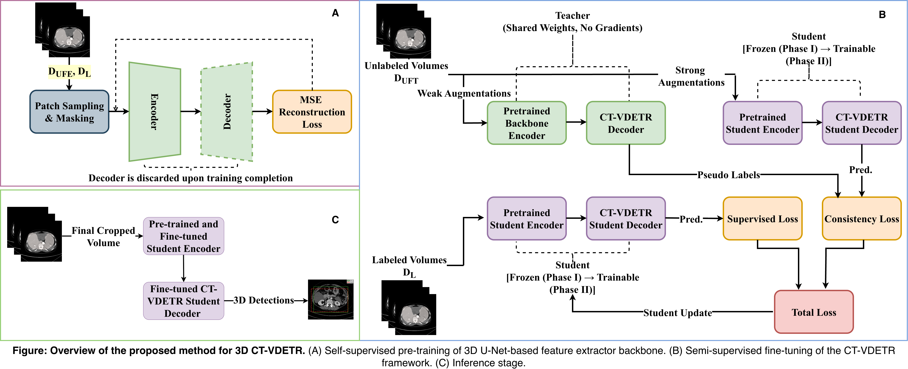

# 3D Abdominal Trauma Detection with Self-Supervised Learning

Official implementation of "Addressing Data Scarcity in 3D Trauma Detection through Self-Supervised and Semi-Supervised Learning with Vertex Relative Position Encoding".

**Authors:** Shivam Chaudhary, Sheethal Bhat, Andreas Maier  
**Affiliation:** Pattern Recognition Lab, Friedrich-Alexander-Universität Erlangen-Nürnberg  
**Paper:** arXiv (Coming Soon)

## Method Overview



Our pipeline consists of three stages:

1. Self-Supervised Pre-training: 3D U-Net encoder trained on 1,000 unlabeled CT volumes using masked patch reconstruction (75% masking ratio)
2. Semi-Supervised Detection: VDETR with 3D Vertex Relative Position Encoding trained with consistency regularization on 2,000 unlabeled volumes
3. Injury Classification: Frozen encoder fine-tuned for multi-label injury classification

## Model Weights

Pre-trained weights are hosted on Google Drive:

| Model | Description | Size | Download |
|-------|-------------|------|----------|
| 3D U-Net Encoder | Self-supervised MIM pre-training (liver) | 22 MB | [Google Drive](https://drive.google.com/drive/folders/1nQ68k1njgwCOcT-xzH4gBGsrL9d_Wsi7?usp=drive_link) |
| CT-VDETR (Semi-Supervised) | Liver detector trained with consistency regularization | 197 MB | [Google Drive](https://drive.google.com/drive/folders/1nQ68k1njgwCOcT-xzH4gBGsrL9d_Wsi7?usp=drive_link) |

After downloading, place the files as follows:

```
3d-trauma-detection-ssl/
├── unet_liver_encoder_ckpt/
│   └── 3D_unet_liver_ssl_weights.pth
└── detector/
    └── checkpoints/
        └── best_model.pth
```

Paths are set in `detector/configs/config.yaml` (`unet_checkpoint`) and in `detector/test_vdetr.sh` (`BEST_CHECKPOINT`). Adjust them if you store the weights elsewhere.

## Citation

If you find this work useful, please cite:
```bibtex
@article{chaudhary2026trauma,
  title={Addressing Data Scarcity in 3D Trauma Detection through Self-Supervised and Semi-Supervised Learning with Vertex Relative Position Encoding},
  author={Chaudhary, Shivam and Bhat, Sheethal and Maier, Andreas},
  journal={arXiv preprint},
  year={2026}
}
```

And the original V-DETR:
```bibtex
@inproceedings{shen2023vdetr,
  title={{V-DETR}: {DETR} with Vertex Relative Position Encoding for {3D} Object Detection},
  author={Shen, Yichao and Geng, Zigang and Yuan, Yuhui and Lin, Yutong and Liu, Ze and Wang, Chunyu and Hu, Han and Zheng, Nanning and Guo, Baining},
  booktitle={Proceedings of the IEEE/CVF International Conference on Computer Vision},
  pages={6857--6867},
  year={2023}
}
```

## Acknowledgments

This work builds upon [V-DETR](https://github.com/V-DETR/V-DETR) by Shen et al. Dataset from RSNA 2023 Abdominal Trauma Detection Challenge. Computing resources provided by NHR@FAU.

## License

MIT License. 

## Contact

shivam.chaudhary@fau.de